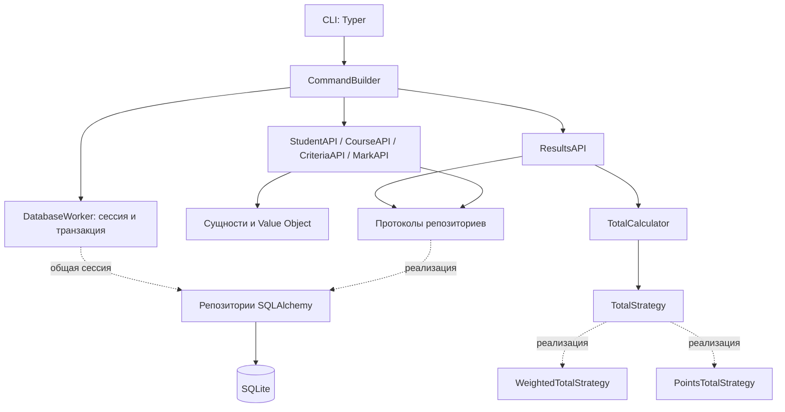

# Архитектура DigitalDnevnik

Документ описывает текущую реализацию учебного модуля DDnevnik. Установка, полный справочник команд и пользовательские примеры находятся в [README.md](README.md).

Приложение рассчитано на одного пользователя и локальный запуск из консоли. Основные сценарии: завести студентов и курсы, собрать рубрикатор, выставлять и исправлять оценки, получать актуальные итоги и экспортировать ведомость курса.

## 1. Выбор инструментов и границы задачи

| Инструмент | Назначение и причина выбора |
| --- | --- |
| Python 3.10+ | Язык приложения; аннотации используются во входных контрактах и протоколах |
| Typer | Разбор аргументов CLI, группы команд, справка и сообщения пользователю |
| Pydantic 2 | Проверка параметров маршрутов и преобразование результатов в DTO |
| SQLAlchemy 2 | ORM-модели, запросы, сессии и транзакции |
| SQLite | Локальная БД в одном файле, без отдельного сервера; в тестах — БД в памяти |
| platformdirs | Выбор каталога данных пользователя |
| unittest | Проверки без дополнительной зависимости для тестирования |

Несколько курсов поддерживаются уже сейчас. Пересдачи, история изменения оценок, авторизация, даты и комментарии к оценкам не реализованы. Итог всегда вычисляется из текущего состояния рубрикатора и оценок.

## 2. Структура проекта и направление вызовов

```text
src/ddnevnik/
    cli.py                 сборка CLI и корневой параметр --db
    apps/                  команды Typer, вывод JSON и экспорт CSV
    core/                  базовый API, четыре API сущностей и ResultsAPI
    schemas/               входные схемы, DTO, протоколы репозиториев и TotalStrategy
    models/                ORM-сущности и неизменяемые Value Object
    repositories/          student.py, course.py, criteria.py, mark.py
    command_builder.py     сборка и выполнение пакетов команд
    workers/               DatabaseWorker, TotalCalculator и стратегии расчёта
    utils/                 Router и декоратор route
    errors.py              ошибки приложения
tests/
    test_commands.py       сценарии, ошибки, ветвление и подмена репозитория
```



Протокол — контракт для API, а не промежуточный объект во время выполнения. Конкретный экземпляр репозитория передаётся в конструктор API. SQL-запросы сосредоточены в `repositories`, создание соединений и управление транзакциями — в `DatabaseWorker`. Модели и расчёт итога не обращаются к Typer, CSV или JSON.

## 3. DDD

| Термин | Представление в коде | Смысл |
| --- | --- | --- |
| Студент | `Student` | Человек, которого оценивают |
| Курс | `Course` | Контекст зачисления и оценивания |
| Критерий | `Criterion` | За что ставят баллы; содержит название и общий максимум |
| Рубрикатор курса | `Course.rubric`, `CourseCriterion` | Критерии, включённые в конкретный курс, и их веса |
| Зачисление | `Enrollment` | Связь конкретного студента с конкретным курсом |
| Оценка | `Mark` | Балл студента по критерию в рамках курса |
| Балл | `Score` | Значение оценки, проверенное по диапазону критерия |
| Максимальный балл | `MaxScore` | Положительный максимум критерия |
| Вес | `Weight` | Конечный положительный вклад критерия в итог |
| Итог | `TotalResult`, `TotalCalculator` | Вычисленный процент и заполненность рубрикатора |

Один критерий может использоваться в нескольких курсах. Его `max_score` общий для всех курсов, а вес хранится в `CourseCriterion` и может различаться между курсами. Имена не используются как идентификаторы: совпадающие имена студентов и названия критериев допустимы.

### Entity и Value Object

`Student`, `Course`, `Criterion`, `Enrollment`, `CourseCriterion` и `Mark` — сущности с идентичностью. Переименование студента не создаёт нового человека. Изменение балла изменяет существующую оценку, определяемую тройкой идентификаторов.

| Entity | Идентичность |
| --- | --- |
| `Student`, `Course`, `Criterion` | `id` |
| `Enrollment` | `(student_id, course_id)` |
| `CourseCriterion` | `(course_id, criterion_id)` |
| `Mark` | `(student_id, course_id, criterion_id)` |

Это предметная идентичность; собственный универсальный механизм `Entity.__eq__` в проекте не вводился.

`Score`, `MaxScore` и `Weight` реализованы как `dataclass(frozen=True)` со сравнением по значению и проверкой при создании. Например, `Score(8, MaxScore(10)) == Score(8, MaxScore(10))`. При изменении оценки создаётся новый `Score`. [Value Object](src/ddnevnik/models/value_objects.py).

Сущности одновременно являются моделями SQLAlchemy. `composite()` связывает `MaxScore` и `Weight` с колонками. Свойство `mark.score` создаёт `Score` из сохранённого балла и максимума связанного критерия. Для загрузки этой связи нужна активная ORM-сессия. Числовое свойство `Mark.value` доступно в SQL-запросах.

| Сущность | VO в Python | Колонка SQLite |
| --- | --- | --- |
| `Mark` | `score: Score` | `value INTEGER` |
| `Criterion` | `maximum: MaxScore` | `max_score INTEGER` |
| `CourseCriterion` | `importance: Weight` | `weight FLOAT` |

Поля `value`, `max_score` и `weight` доступны как числовые свойства. Поэтому существующие запросы и DTO не обязаны раскрывать внутреннее устройство VO. У `Mark` и `Criterion` присваивания проходят через защищённые свойства и доменные методы.

### Границы агрегатов и согласованности

Для локального приложения выбраны небольшие границы изменения:

- `Student` — отдельная сущность: изменение имени не требует загрузки всех курсов и оценок.
- `Criterion` — отдельная сущность общего справочника. Её максимум влияет на оценки в нескольких курсах, поэтому изменение требует проверки максимальной уже выставленной оценки.
- `Course` — точка управления составом рубрикатора через `CourseCriterion`.
- `Mark` — отдельная изменяемая сущность со своим `Score`; остальные сущности представлены идентификаторами и ссылками.
- `Enrollment` — сущность связи. Сценарий зачисления проверяет обе стороны и запрещает повторную связь.

Не создаётся большой агрегат, который загружает весь курс со всеми студентами и оценками. Межобъектные правила проверяются сценариями API и внешними ключами, а согласованность изменений обеспечивает транзакция.

Это упрощённое применение агрегатов: единого закрытого корня, через который физически проходят все изменения коллекций `Course`, в коде нет. `CourseAPI` и `StudentAPI` могут создавать зачисления через свои репозитории. Каскад внешнего ключа означает правило удаления в хранилище и сам по себе не определяет принадлежность к DDD-агрегату.

### Инварианты и место их проверки

| Правило | Реализация |
| --- | --- |
| Балл неотрицательный | `Score.__post_init__`, входные схемы и `CHECK value >= 0` |
| Максимум строго положительный | `MaxScore.__post_init__`, входные схемы и `CHECK max_score > 0` |
| Вес конечный и положительный | `Weight.__post_init__`, входная схема; `CHECK weight > 0` дополнительно проверяет нижнюю границу |
| Балл не превышает максимум | `Score.__post_init__` проверяет максимум при создании. `Mark.create` и `Mark.set_score` передают максимум критерия. Сеттеры `value` и `score` используют этот же путь |
| Новый балл требует контекста критерия | Присваивание новой оценке без критерия отклоняется; штатное создание — через `Mark.create` |
| Критерий соответствует оценке | `Mark.set_score` сравнивает идентификатор критерия |
| Студент зачислен на курс | `MarkAPI._validate_target`; составной FK из `marks` в `enrollments` |
| Критерий включён в курс | `MarkAPI._validate_target`; составной FK из `marks` в `course_criteria` |
| Максимум нельзя уменьшить ниже выставленных баллов | Репозиторий получает наибольшую оценку; `Criterion.change_maximum` проверяет новое значение |
| Прямое уменьшение максимума не обходит проверку | Свойства `max_score` и `maximum` требуют использовать `change_maximum` |
| Нет повторного зачисления, критерия курса и оценки | Предметные проверки API и составные первичные ключи |
| Итог соответствует текущим данным | Вычисляется при запросе; отдельное сохранённое поле итога отсутствует |

Входные Pydantic-схемы проверяют обязательные поля, типы и формат запроса. Доменная модель проверяет допустимость значений и изменения состояния. FK и CHECK дополнительно защищают сохранённые связи и простые ограничения.

Скрытые ORM-поля предназначены для маппинга, а не для изменения из прикладного кода. Прямой SQL и изменение внутренних полей в обход доменных операций не получают всех гарантий модели: межтабличная проверка максимума больше не выполняется триггером.

Все связи удаления настроены с `ON DELETE CASCADE`. Удаление студента удаляет его зачисления и оценки; удаление курса — зачисления, рубрикатор и оценки; удаление критерия — его включения в курсы и связанные оценки. Отменить одну оценку можно отдельно, сохранив зачисление и рубрикатор.

### Repository: порт и адаптер

[Протоколы репозиториев](src/ddnevnik/schemas/repositories.py) описаны через `typing.Protocol`. Общий контракт содержит `get`, `list`, `save`, `delete`, а четыре предметных протокола добавляют необходимые операции со связями и выборками.

| Порт | Реализация |
| --- | --- |
| `StudentRepository` | [SQLAlchemyStudentRepository](src/ddnevnik/repositories/student.py) |
| `CourseRepository` | [SQLAlchemyCourseRepository](src/ddnevnik/repositories/course.py) |
| `CriteriaRepository` | [SQLAlchemyCriteriaRepository](src/ddnevnik/repositories/criteria.py) |
| `MarkRepository` | [SQLAlchemyMarkRepository](src/ddnevnik/repositories/mark.py) |

API использует предметные операции вроде `get_student_marks` и `get_rubric`, а не `select`, `join` и `session.flush`. Репозитории получают общую сессию снаружи и не выполняют самостоятельный `commit`: граница транзакции принадлежит выполнению пакета команд.

Репозиторий не создаётся автоматически для каждой таблицы. Операции с `Enrollment` и `CourseCriterion` включены в существующие предметные контракты. Так сохраняются четыре реализации без дополнительных уровней для простых связей.

Ограничение выбранного решения: протоколы возвращают в том числе ORM-сущности. SQLAlchemy скрывает детали запросов, но полного отделения доменных типов от ORM нет.

### Domain Service и Strategy расчёта итога

`ResultsAPI` выполняет сценарии получения ведомости курса, итога студента по курсу и итогов по всем его курсам. Он получает данные через `CourseRepository` и `StudentRepository`, выбирает способ расчёта и формирует ответ. Формулы выполняются стратегиями через `TotalCalculator`. [ResultsAPI](src/ddnevnik/core/results.py).

`TotalCalculator` — доменный сервис, который принимает рубрикатор и оценки, делегирует формулу стратегии, округляет результат и считает заполненность. Контракт алгоритма задаёт `TotalStrategy`. Метод `set_strategy` заменяет текущую реализацию. [Счётчик и стратегии](src/ddnevnik/workers/scoring.py), [протокол](src/ddnevnik/schemas/scoring.py).

| Значение `strategy` | Реализация | Формула |
| --- | --- | --- |
| `weighted` по умолчанию | `WeightedTotalStrategy` | `100 × Σ(weight × score / max_score) / Σ(weight)` |
| `points` | `PointsTotalStrategy` | `100 × Σ(score) / Σ(max_score)` |

Для `points` вклад критерия определяется его максимальным баллом. Параметр `weight` используется в `weighted`.

Все три команды `ResultsAPI` принимают `strategy`. Схема проверяет имя, после чего обработчик вызывает `calculator.set_strategy(create_strategy(request.strategy))`. При пропуске аргумента выбирается `weighted`, в том числе после предыдущего расчёта с `points`. Каждый объект `ResultsAPI` получает собственный счётчик.

Невыставленная оценка считается нулём. Критерий остаётся в знаменателе соответствующей формулы. Выставленный ноль считается заполненным критерием. При пустом рубрикаторе итог равен `None`. Поля `completed_criteria` и `total_criteria` отражают заполненность при любом методе расчёта.

Для домашней работы 8 из 10 с весом 1 и экзамена 18 из 20 с весом 3 получаются следующие результаты.

```text
weighted = 100 × (1 × 8/10 + 3 × 18/20) / (1 + 3) = 87.5
points   = 100 × (8 + 18) / (10 + 20) = 86.67 после округления
```

После исправления домашней работы на 10 метод `weighted` возвращает `92.5`, после отмены экзамена — `25.0`. Если выставлена только домашняя работа 8 из 10, `weighted` возвращает `20.0`, а `points` — `26.67`. В обоих случаях заполненность равна 1 из 2.

Сервис получает подготовленные DTO и выполняет вычисления в памяти. Совместимая функция `calculate_total` делегирует расчёт `TotalCalculator` с методом `weighted`.

## 4. Выполнение команд и контракты API

[API](src/ddnevnik/core/base.py) предоставляет общий метод `execute(router_name, **kwargs)`. Наследники принимают соответствующий протокол репозитория через `API[StudentRepository]` и аналогичные специализации.

Метод, помеченный `@route("имя")`, попадает в реестр при создании API. Сам декоратор сохраняет метаданные; базовый API находит методы и регистрирует их в [Router](src/ddnevnik/utils/router.py).

Router проверяет аргументы через Pydantic `validate_call`, используя аннотации функции. Нет обязательного имени параметра схемы на уровне Router; текущие предметные обработчики используют `request`. Ошибки параметров преобразуются в `InvalidParametersError`. Предметные ошибки возникают при исполнении обработчика и сохраняют свой тип.

`CommandBuilder` накапливает команды и исполняет их в порядке добавления. [command_builder.py](src/ddnevnik/command_builder.py).

```python
from ddnevnik.command_builder import CommandBuilder
from ddnevnik.workers import DatabaseWorker

database = DatabaseWorker(":memory:")
database.create_tables()
try:
    student, course = (
        CommandBuilder(database)
        .add_command("students", "add", request={"name": "Иван"})
        .add_command("courses", "add", request={"name": "Python"})
        .execute()
    )
finally:
    database.close()
```

`execute()` возвращает список результатов, включая результат каждой промежуточной команды. Все команды пакета используют одну транзакцию. Ошибка останавливает выполнение и откатывает весь пакет. Очередь очищается при попытке выполнения, в том числе при ошибке. Вызов пустой очереди вызывает `IncompleteCommandError`.

По умолчанию `add_command(..., in_place=True)` изменяет текущий билдер и возвращает `self`. `in_place=False` создаёт новый билдер с копией накопленной очереди и новой командой. Это позволяет построить общую часть сценария и разветвить её на успешный и ошибочный варианты.

Копируется список команд, а не вся БД и не глубокое содержимое аргументов. При переданном `DatabaseWorker` ветки используют одно хранилище. Каждая попытка `execute()` имеет отдельную транзакцию: успешная ветка сохраняет изменения, ошибочная откатывается. Данные, сохранённые одной успешной веткой, доступны следующим выполнениям.

Описание вызовов `ResultsAPI`, параметры команд и практические примеры находятся в [основном README](README.md#использование-resultsapi-из-python).

CLI использует тот же билдер с одной командой и извлекает её результат из списка. JSON и CSV формируются в `apps`, вне моделей и расчёта итога.

## 5. Применение SOLID

| Принцип | Где применяется |
| --- | --- |
| S — Single Responsibility | CLI отвечает за ввод/вывод, API — за сценарий, модели и VO — за состояние и правила, репозитории — за запросы, `ResultsAPI` — за получение результатов, `TotalCalculator` — за вычисление итога |
| O — Open/Closed | Новый маршрут добавляется методом с `@route`, без изменения базового `execute`; новый критерий добавляется данными |
| L — Liskov Substitution | Наследники API сохраняют механизм `execute` и единый способ выдачи ошибок; репозиторий используется по контракту |
| I — Interface Segregation | Вместо единого репозитория всего приложения используются четыре протокола по потребностям API |
| D — Dependency Inversion | API принимает протокол, а реализация передаётся снаружи; подмена проверяется тестом |

Протоколы репозиториев задают границу хранения и позволяют подменять зависимости. `TotalStrategy` задаёт контракт расчёта, которому соответствуют два алгоритма. Их выбор обрабатывается в `ResultsAPI`, а новые формулы добавляются в модуль расчётов и фабрику стратегий.

## 6. GoF: выбранные паттерны и их задача

| Группа | Паттерн | Где и зачем |
| --- | --- | --- |
| Порождающий | Builder | `CommandBuilder.add_command` пошагово собирает пакет; `in_place=False` позволяет развить общую часть сценария в несколько вариантов. Клиенту не нужно вручную координировать список вызовов и транзакцию |
| Порождающий | Factory Method в прикладном смысле (Simple Factory) | `CommandBuilder._create_api` по имени выбирает класс API, создаёт нужный репозиторий на сессии пакета и передаёт его в конструктор API. Сборка конкретных реализаций сосредоточена в одном методе |
| Структурный | Facade | Предметные API предоставляют сценарии через единый `execute`. CLI передаёт имя маршрута и параметры, а проверки, работа с репозиторием и расчёт скрыты за API |
| Структурный | Decorator | `Router.register` оборачивает обработчик в `validated_handler`. Обёртка проверяет аргументы через Pydantic, преобразует ошибки проверки и вызывает исходный обработчик. Обработчики маршрутов используют общую валидацию |
| Поведенческий | Strategy расчёта итога | `TotalCalculator` хранит объект по протоколу `TotalStrategy`. `ResultsAPI` по параметру команды выбирает `WeightedTotalStrategy` или `PointsTotalStrategy` и передаёт его счётчику через `set_strategy`. Счётчик делегирует вычисление выбранному алгоритму |

Builder реализован в упрощённом виде: собранный пакет хранится внутри билдера и сразу выполняется через `execute`, отдельного продукта `CommandBatch` и метода `build` нет.

Роли Strategy распределены следующим образом.

| Роль | Реализация |
| --- | --- |
| Контекст | `TotalCalculator` хранит текущую стратегию и вызывает её `calculate` |
| Контракт стратегии | Протокол `TotalStrategy` принимает рубрикатор и оценки, возвращает процент или `None` для пустого рубрикатора |
| Конкретные стратегии | `WeightedTotalStrategy` и `PointsTotalStrategy` реализуют разные формулы |
| Выбор и замена | Команда `ResultsAPI` передаёт `request.strategy` в `create_strategy`, затем вызывает `calculator.set_strategy` |

Параметр `strategy` относится к одной команде расчёта. Стратегии вычисляют процент, а `TotalCalculator` округляет его до двух знаков и формирует общий `TotalResult` с заполненностью. Это позволяет добавлять алгоритмы, сохраняя формат результатов.

По структуре `_create_api` — Simple Factory с выбором типа через `if`. В классическом GoF Factory Method создание конкретного продукта определяют подклассы создателя. [Сборка API](src/ddnevnik/command_builder.py).

У `@route` своя задача. Он сохраняет имя маршрута как метаданные для регистрации. Декорирование вызова выполняет обёртка `validated_handler`. [Router](src/ddnevnik/utils/router.py).

## 7. DI, место сборки и время жизни

В проекте реализован ручной DI через конструкторы:

```python
api = StudentAPI(SQLAlchemyStudentRepository(session))
```

`ResultsAPI` получает репозитории курса и студента, использующие общую сессию пакета. Его счётчик создаётся при инициализации API. Выбранная командой стратегия передаётся счётчику через сеттер.

`StudentAPI` знает контракт репозитория, но не создаёт сессию и не выбирает реализацию. `_run` в `apps/common.py` создаёт `DatabaseWorker`, а `CommandBuilder._create_api` централизованно собирает конкретный API с репозиторием.

| Объект | Время жизни |
| --- | --- |
| `DatabaseWorker` и engine | В CLI — на один вызов команды; в программном сценарии могут использоваться несколькими пакетами |
| Session и транзакция | На один вызов `CommandBuilder.execute()` |
| API и репозиторий | Создаются для каждой команды пакета и используют общую сессию |
| `TotalCalculator` | Создаётся в конструкторе `ResultsAPI` и живёт вместе с этим экземпляром API |
| Объект стратегии | Создаётся через `create_strategy` и устанавливается в начале каждого вызова команды `ResultsAPI` |
| VO | Неизменяемое значение, заменяется новым при изменении |

Билдер создаёт новый `ResultsAPI` для каждой команды. При повторном использовании одного экземпляра `ResultsAPI` обработчик также устанавливает стратегию из нового запроса. Если поле `strategy` пропущено, применяется значение `weighted` из схемы запроса. Поэтому последовательность `weighted → points → запрос без strategy` даёт расчёты `weighted → points → weighted`.

При внешнем `DatabaseWorker` ресурс закрывает вызывающий код. Если билдер создаёт его сам, для освобождения предусмотрен `CommandBuilder.close()`. В CLI закрытие выполняется в `finally`.

Зависимости собираются на границе приложения, бизнес-объекты не получают контейнер или Service Locator. В тесте репозиторий заменяется объектом по `StudentRepository`, а постоянное хранилище — SQLite в памяти.

**Различие с DI-контейнером:** отдельного механизма регистрации фабрик и автоматического разрешения графа в коде нет. Typer регистрирует команды CLI, но не собирает репозитории для API. Текущее решение — ручной DI с централизованной фабрикой, которая выполняет часть обязанностей контейнера. Для небольшого графа сохранена явная сборка; автоматизированный DI-контейнер, отдельно названный в ТЗ, не реализован.


## 8. Тесты и подмена зависимостей

[tests/test_commands.py](tests/test_commands.py) содержит пять тестов:

| Тест | Что подтверждает |
| --- | --- |
| `test_course_scenario` | Создание данных через пакеты команд, учёт пропусков, итог 20 → 87.5 → 92.5 → 25, заполненность и структура ведомости |
| `test_branches_are_independent_and_failed_batch_rolls_back` | Разветвление через `in_place=False`, сохранность исходной очереди, откат ошибочной ветки и успешное выполнение другой |
| `test_invalid_commands_preserve_marks` | Превышение максимума, отрицательный балл, дубликат, критерий вне рубрикатора, незачисленный студент, недопустимое уменьшение максимума и неполные параметры |
| `test_model_setters_preserve_invariants` | Проверки при прямом изменении публичных полей моделей; допустимое изменение балла и максимума сохраняется |
| `test_api_accepts_repository_substitute` | API получает подмену репозитория по протоколу и вызывает её без подключения к БД |

Тесты команд используют `DatabaseWorker(":memory:")`: настоящие SQLAlchemy-модели, связи и транзакции работают с временной SQLite в оперативной памяти. Файлы БД и пользовательские данные не затрагиваются.

Переключение методов `weighted → points → weighted`, запросы одного студента и ведомости курса дополнительно проверяются ручным сценарием на временной SQLite. Для исходных оценок результаты составляют `87.5 → 86.67 → 87.5`.

Это интеграционные проверки небольших сценариев. Отдельная проверка API с `create_autospec(StudentRepository)` является unit-тестом с подменой зависимости. CLI и запись CSV этими тестами не покрываются; они проверяются сквозным консольным примером.


## 9. Роль ИИ

Я самостоятельно спроектировал приложение и принял все архитектурные решения. ИИ я использовал для написания части кода. Весь код, написанный с его помощью, я затем полностью проверил и отревьюил.

Всю документацию написал ИИ с моими указаниями, где я, что использовал. Я полностью проверил её на соответствие реализации и провёл ревью.

